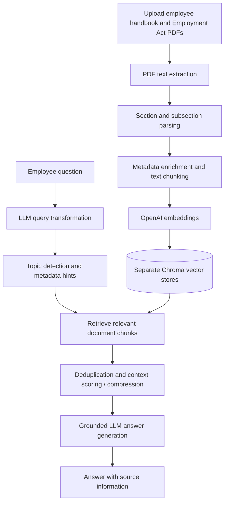

# 🤖 HR Policy RAG Assistant

An AI-powered **HR policy question-answering assistant** built with **Retrieval-Augmented Generation (RAG)**. The system retrieves relevant information from an employee handbook and Malaysia's Employment Act 1955, then uses an LLM to produce contextual, source-grounded answers.

> **Project type:** Academic prototype / notebook-based AI application  
> **Environment:** Google Colab  
> **Interface:** Interactive chat within a Jupyter Notebook

---

## 🎯 Project Overview

HR information is often distributed across lengthy policy manuals and legislation, making specific answers difficult to locate. This project explores a document-grounded assistant for HR-related questions, such as leave eligibility, working hours, salary payments, attendance, and employment termination.

The prototype uses **two example reference documents**:
- **IIUM Holdings Employee Handbook 2025** — example company policy source.
- **Employment Act 1955 (Act 265)** — statutory reference used for comparison.

The application retrieves relevant passages before generating an answer. When appropriate, it compares the employee handbook with the Act. It is a **research/educational prototype**, not an official IIUM service or a substitute for HR or legal advice.

---

## ✨ Key Features

- **📄 PDF ingestion:** Extracts text from uploaded handbook and employment-law PDFs.
- **🧱 Structure-aware chunking:** Parses handbook sections/subsections and legal Parts/sections, then splits the content into searchable chunks.
- **🏷️ Metadata enrichment:** Preserves information such as document source, section, subsection, and page reference.
- **🔎 Semantic retrieval:** Uses vector embeddings and Chroma to search for relevant policy passages.
- **✍️ Query transformation:** Rewrites conversational questions into focused retrieval queries.
- **🧭 Topic-aware retrieval:** Identifies HR topics and applies metadata hints/filtering to improve relevance.
- **🗜️ Context compression:** Scores and narrows retrieved passages before answer generation.
- **⚖️ Dual-source comparison:** Compares company policy with Employment Act passages when relevant.
- **📌 Grounded answers:** Prompts the language model to use the retrieved evidence and identify sources.
- **💬 Notebook chat:** Provides a question-and-answer interface using `ipywidgets`.
- **🧪 Example test cases:** Includes factual, paraphrased, comparative, out-of-scope, and edge-case questions.

---

## 🛠️ Technology Stack

| Area | Technologies |
| --- | --- |
| Language | Python |
| Development environment | Google Colab, Jupyter Notebook |
| LLM | OpenAI `gpt-4o-mini` |
| Embeddings | OpenAI `text-embedding-3-small` |
| RAG framework | LangChain |
| Vector database | ChromaDB (`langchain-chroma`) |
| PDF processing | `pdfplumber`, `pypdf` |
| Text splitting | `RecursiveCharacterTextSplitter` |
| Notebook interface | `ipywidgets`, IPython display |
| Supporting libraries | pandas, regular expressions, JSON |

---

## 🏗️ RAG System Workflow



### How it works

1. **Ingest** the two PDF documents and extract their text.
2. **Parse** headings and sections to retain policy/legal-document structure.
3. **Chunk and embed** document passages, storing embeddings in separate Chroma collections.
4. **Transform** the user's question into retrieval-friendly wording.
5. **Retrieve and rank** relevant content using semantic search, metadata hints, and additional filtering.
6. **Generate** an answer from selected passages, including a source reference. For comparison questions, the assistant can discuss the handbook and the Employment Act side by side.

---

## 📁 Repository Structure

```text
HR-Policy-RAG-Assistant/
├── HR_Policy_RAG_Assistant.ipynb
├── Akta Kerja 1955 (Akta 265).pdf
├── IIUM Employee-Hanbook-2025.pdf
└── README.md
```

The PDF files are **example reference material**, not source code. The notebook contains the implementation. 

---

## 🚀 Getting Started

### Prerequisites

- Google account with access to **Google Colab**
- OpenAI API key with access to the configured models
- Internet connection and sufficient OpenAI API credits/quota
- Two PDF source documents: an employee handbook and an Employment Act reference

### Run the notebook

1. Download or open [`HR_Policy_RAG_Assistant.ipynb`](./HR_Policy_RAG_Assistant.ipynb) in **Google Colab**.
2. Run the notebook cells **in order**, starting from the dependency installation cell.
3. When prompted, **upload the two reference PDFs together**. The notebook identifies the files by names containing `hanbook`/`handbook` and `akta kerja`/`employment act`.
4. When prompted by `getpass()`, enter your **OpenAI API key**. Do **not** put the key into the notebook source.
5. Continue running the cells to parse documents, build Chroma vector stores, and initialize the RAG pipeline.
6. Use the **in-notebook chat widget** to enter HR questions, or run the included example tests.

> **Note:** The implementation uses Google Colab-specific file upload functions and stores its Chroma collections under temporary `/tmp/` directories. Re-running the notebook in a fresh session rebuilds the vector stores and can incur OpenAI API usage costs.

---

## 💡 Example Questions

The notebook includes examples such as:

- “What are the official working hours?”
- “How long is a new staff member on trial before confirmation?”
- “What is the difference between absenteeism and punctuality?”
- “When must wages be paid under the company policy and the Employment Act?”

These are **example inputs**, not guaranteed responses; output depends on the retrieved passages, source-document versions, and model behavior.

---

## 🧪 Testing and Evaluation

The notebook contains a small test harness covering multiple query types:

| Test category | Purpose |
| --- | --- |
| Factual question | Find direct answers from policy text |
| Paraphrased question | Retrieve a relevant clause despite alternate wording |
| Comparison / reasoning | Distinguish related HR concepts |
| Out-of-scope question | Check handling of unrelated requests |
| Edge case | Compare company policy with statutory information |

It records answers and source usage for inspection. **No independently validated accuracy or benchmark score is claimed here.**

---

## ⚠️ Limitations and Responsible Use

- Outputs are generated by an LLM and may contain errors; verify important answers against the original policy documents and current legislation.
- Retrieval and parsing quality depend on the layout, OCR/text quality, and headings in the uploaded PDFs.
- The current notebook is tailored to the two example documents and their naming/structure; other organizations' documents may require parser adjustments.
- The employee handbook and Employment Act may differ in scope, conditions, or effective dates. The system's comparison is **not a legal determination**.
- The prototype uses an external model API, so **do not upload confidential employee records or private HR documents without appropriate permission and data-handling safeguards**.
- The notebook is a Colab prototype, not a deployed, authenticated enterprise HR application.

---

## 📬 Connect

**GitHub:** [@chongwinnie](https://github.com/chongwinnie)  
**LinkedIn:** [Chong Win Nie](https://www.linkedin.com/in/chongwinnie/)
